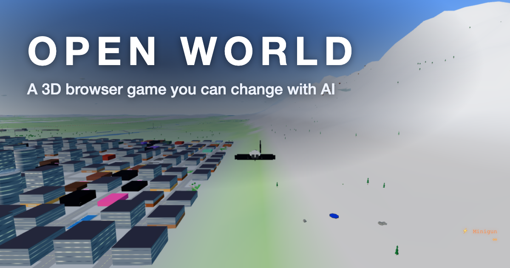

# OpenWorld

**A 3D open world in your browser that you change by describing it.** Drive, glide and explore a city, a beach and mountains, then type a change ("add a day and night cycle", "put ramps on the beach") and AI edits the game. Every change is a new private version you can try, keep or throw away; share only the one you like.

**Play it now: [open-world.gg](https://open-world.gg)** (no install, runs in the browser)

<p align="center">
  <a href="https://open-world.gg"></a>
</p>

- **Play first.** The game runs without an account.
- **Change it in plain words.** Try an included text edit when the shared allowance is available. Saved changes stay private until you share them.
- **Pick up an interrupted edit.** Open **Edit Game** and choose **Check previous edit**. If a version saved, open it from the result.
- **Share and play others' games.** Public games can be played and starred without exposing your chat.
- **Optional own-key mode.** Choose your own Anthropic key to use provider billing for your edits.

Made by [Nir Feinstein](https://nirfeinste.in). Feedback and bug reports are welcome in [Issues](https://github.com/fainir/open-world/issues).

## For developers

Describe a change to the existing browser game, preview a private saved version and explicitly share the game you choose. Live: https://open-world.gg.

The studio uses FastAPI/Python, SQLite, static JavaScript and the existing Three.js game. Included text edits use the shared Claude gateway. Own-key edits use the configured Sonnet model or its explicit Opus override. Executable games run in an opaque sandbox separate from studio credentials, storage and private APIs.

## Run and verify

Use the existing Python environment and documented configuration from `app/.env.example`. Normal local development is `app/venv/bin/python app/run.py`; it may load your local app/.env. Do not use that entry point for offline QA with real provider configuration present.

```sh
app/venv/bin/python -m unittest discover -s tests -v
app/venv/bin/python -m compileall -q app/backend
```

The tests create disposable SQLite data and synthetic users; provider responses are mocked. For an isolated browser fixture that never loads app/.env:

```sh
env -i HOME="$HOME" PATH=/usr/local/bin:/usr/bin:/bin TMPDIR=/tmp \
  app/venv/bin/python qa/local.py --lightweight-game
```

This lightweight mode verifies the real studio/account UI only, not gameplay or performance. Omit that flag for the unchanged real base game. The fixture prints its loopback URL and a private credential-file path, then removes its data on shutdown. Do not put that file in a repository or run QA against owner accounts.

## Existing production deployment

`railway up --detach` uploads this source to the already-linked OpenWorld service. Confirm the project/service with `railway status` first, keep one worker/replica, and preserve the DATA_DIR/VERSIONS_DIR persistent volume. This task does not create another service, volume, account, key or provider commitment.

Run the changed-flow browser checks and read [READINESS.md](READINESS.md) before deployment. Production `/healthz` must report a healthy database, referenced game files and fresh verified recovery. Verify public studio/account/privacy/contact pages after the rollout. The coordinator owns deployment and the final public acceptance.

Rollback means redeploy a compatible application build to this same service while preserving the volume. Never restore an old database over live user data for a deployment rollback. Account-removal evidence and the deletion-aware recovery helper must be retained; an older recovery command may not serve restored traffic. See [OPERATIONS.md](OPERATIONS.md).

## Data controls

`/account` downloads a scoped ZIP with profile, chat, version metadata and owned game HTML. It excludes credential hashes and other users. Account closure requires the current password and typed DELETE, removes active account data and game files, and invalidates old sign-in tokens. Failure recovery protects the other accounts and restores the caller's files/rows when the transaction fails.

The persistent account-ID-only deletion log is included in new snapshots. An older backup is restored only with current surviving deletion evidence, applied before traffic. Historical encrypted copies rotate separately; they are not claimed to disappear immediately. `/privacy` explains storage, providers, removal and operator contact. Anonymous contact messages are separate from unverified account emails.

## Configuration

| Variable | Purpose |
|---|---|
| JWT_SECRET | Stable private production secret of at least 32 characters; retain during redeploy |
| DATA_DIR | Persistent database, base game, deletion evidence and recovery snapshots |
| VERSIONS_DIR | Persistent generated game files |
| BASE_GAME_PATH | Optional explicit base game; default is the persistent copy |
| STUDIO_ORIGINS | Existing allowed studio origin list; no widened scope is required |
| OPENWORLD_MODEL | Existing Sonnet default or explicit supported Opus override |
| SEED_DEMO_STORE | Keep disabled on production; no automatic reseeding |
| PORT | Existing hosting listener port |

Keep provider keys private. Run `bash scripts/ci-local.sh` for local dependency checks, Python compilation and synthetic tests.

Current scope and evidence are in [PRODUCT.md](PRODUCT.md) and [READINESS.md](READINESS.md).

## Optional public analytics

Public `/` and `/privacy` have an accessible Analytics choices dialog, off by default, honoring DNT/GPC and clearing accessible identifiers on withdrawal. Only configured providers load: `GA_ID` (public GA4 measurement ID), `MIXPANEL_TOKEN` (public US Mixpanel project token), `BETTERLOOP_KEY` (public browser write key). `/analytics-config.js` validates/exposes only those public identifiers; private API tokens must never be used there. Blank/invalid values disable that provider. Disable GA enhanced measurement on the stream; the site uses manual sanitized pageviews and fixed events.

The analytics script is never included in admin/account/contact or standalone games. Version-editor paths also suppress analytics. `node --test qa/analytics.test.cjs` checks consent, routes, withdrawal and pending-script races without real provider calls. `node qa/check-analytics.mjs <loopback-origin> <installed-playwright-entry>` checks the real public shell with synthetic vendor responses. The coordinator owns public identifier configuration and existing-service rollout; preserve volume, stored games and mirror configuration.


Contact, Privacy and Terms/current costs are available from the studio. Play and account features are free. Choose an available included text edit or use your own Anthropic key with provider billing. New contact forms are saved and queued for an operator email. The admin inbox shows notification state. [Delivery and retry details](OPERATIONS.md#contact-notifications)

## License

MIT, see [LICENSE](LICENSE).

### Railway compatibility

The existing production service is configured by the portfolio's `portfolio-openworld-web` named partial in the private product-readiness repository (`.railway/openworld.ts`). It leaves variables, source and domains unmanaged. The existing mounted volume is declared with its exact unchanged region, size, alerts and mount, to prevent the CLI from detaching it; this metadata adoption never creates, resizes or replaces storage. The legacy `railway.toml` is removed before its December1 retirement; `nixpacks.toml` remains the supported build recipe. Retain the NIXPACKS builder, existing uvicorn start command, `/healthz`, 30-second health timeout, ON_FAILURE/3 restarts and one us-west2 replica. Verify a zero-diff plan, a completed source deployment with no resolved legacy file, saved game-volume identity and healthy public gameplay/health. No model call or user-data change is needed for this check.
